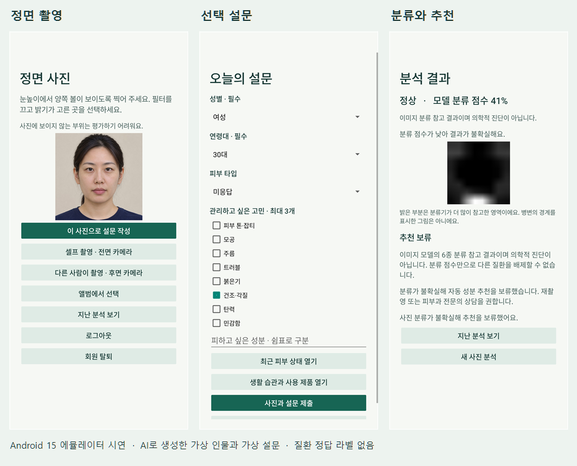

# 스킨케어 Android

Android 9(API 28) 이상에서 정면 또는 측면 사진 한 장과 설문을 Spring Boot에 보낸다. 촬영 각도는 셀프·후면 카메라 및 앨범 선택과 독립적이다. 측면은 기기 안에서 얼굴 수와 방향을 확인하고, 팀 서버가 측면 DINOv2 사용 가능 상태를 응답할 때 제출한다. 얼굴 전체가 보이는 측면을 대상으로 하며 병변 단독 확대 촬영은 지원 범위 밖이다.

홈의 **매일 피부 기록**에서 오늘 느낀 편안함(0~10)과 사용 제품을 기록할 수 있다. 같은 날짜를 다시 저장하면 그날의 값이 바뀐다. 날짜별 막대와 직전 기록 대비 변화량을 제공한다. 기록은 기기·서버·계정별로 분리된다. 추천 상세에는 출처가 있는 관리·식습관 안내와 추천 성분·회피 조건이 일치하는 제품 예시가 표시된다.

## 실행

Android Studio에서 이 디렉터리를 연다. Android SDK Platform 35, Android Build Tools 34.0.0, JDK 17 또는 21을 사용한다. Windows 빌드는 다음과 같다.

```powershell
.\gradlew.bat :app:assembleDebug
```

결과는 `app/build/outputs/apk/debug/app-debug.apk`에 생긴다. 에뮬레이터의 기본 Spring 주소는 `http://10.0.2.2:3000/api/v1`이다. 실제 휴대폰에서는 APK를 설치한 뒤 로그인 화면의 **서버 연결 설정**에 팀의 **Spring HTTPS 주소**를 입력한다. 주소는 `/api/v1`로 끝나야 한다. AI 서버와 내부 토큰은 Spring에서 설정한다. 운영용은 팀 인증서로 서명하고 배포 주소를 빌드에 지정한다.

```powershell
.\gradlew.bat :app:assembleRelease "-PspringBaseUrl=https://backend.example.org/api/v1"
```

두 앱의 Release 기본 주소는 `https://skincare.doi2.my/api/v1`이다. Android는 `X-Client: android`를 보내고 액세스 토큰은 메모리에 둔다. 재실행 시 Android Keystore 키로 암호화해 서버별로 저장한 리프레시 토큰을 사용한다. 로그아웃·회원 탈퇴 시 해당 서버의 세션을 지운다. 이력에서 개별 분석을 선택해 삭제할 수 있다.

## 멘토링 시연 순서

[팀 서버 추천 완료 시연](docs/analysis-team-recommendation-demo.mp4)은 약 50초다. 가상 인물 사진과 설문을 실제 팀 Spring 서버에 제출했다. 8443 FastAPI의 추천 결과를 받아 Android에 성분 1개와 관리 루틴 2단계를 표시했고, 이력에서도 다시 조회했다. 이 요청에서 사진 제출부터 추천 표시까지 17.0초가 걸렸다. AI 응답의 모델 식별자를 팀 서버 배포본의 40자 필드에 맞춘 뒤 확인한 결과다.

Android 15 에뮬레이터에서 가상 인물의 사진과 설문으로 실행한 화면이다. 이 사례는 모델 분류 점수가 낮아 추천이 보류됐다.



[Android 팀 서버 연동 시연](docs/analysis-team-server-demo.mp4)은 약 33초다. 가상 인물 사진 확인, 증상 설문, 팀 Spring 서버와 8443 FastAPI의 분석 결과, 추천 보류 및 이력 조회 화면을 담았다. 쿠키 기반 세션 갱신도 같은 팀 서버에서 확인했다. 녹화 시점의 팀 서버에서는 선택 증상 응답이 분석 이력에 반환되지 않았다. [백엔드 선택 증상 저장 변경](https://github.com/AI-SkinCare/skincare-backend/pull/1) · [AI 평가 결과](https://github.com/AI-SkinCare/skincare-ai/pull/4)

1. 계정으로 로그인한다. 촬영 방법을 선택하거나 시스템 파일 선택기에서 사진 한 장을 고른다. 카메라는 앱 메모리에서 사진을 처리한다. 짧은 변 720px 미만, 거의 단색인 사진, 한 사람의 얼굴을 충분한 크기로 검출하지 못한 사진에는 재촬영 안내가 뜬다. 업로드용 JPEG에는 원본 위치 메타데이터를 복사하지 않는다.
2. 성별·연령대를 선택하고 피부 타입, 관리 고민(최대 3개), 회피 성분 등 필요한 설문을 입력한다. 최근 증상 여섯 항목은 저장 기능이 배포된 백엔드에서 해당 분석의 자가 응답으로 확인할 수 있다. 현재 서비스에서 질환 분류기에 들어가는 입력은 사진이다.
3. 접수 뒤 분류 라벨·모델 점수를 먼저 보고 추천이 처리되는 동안 기다린다. Grad-CAM이 유효하면 참고 영역을 볼 수 있다. 추천이 생성되면 성분의 용도와 시간대별 루틴을 읽을 수 있다. 근거 카드·규칙 대체와 추천 보류는 서버 응답에 따라 표시한다.
4. **지난 분석 보기**에서 같은 결과를 다시 연다. 생성 실패 건은 **추천 다시 요청**을 사용할 수 있다.

## 연동 테스트

전·후면 가상 카메라가 모두 활성화된 API 35 에뮬레이터와 기본 주소의 **시험용** Spring DB를 사용한다. 테스트가 임시 계정을 만들고 정리한다. 시험은 시스템 선택기가 돌려주는 URI부터 사진 변환·한 사람 얼굴 확인·제출을 실행하며, 가상 카메라의 실제 JPEG 콜백도 전·후면 각각 확인한다. 분석 이력을 조회할 때 만료된 액세스 토큰을 재현해 세션 갱신도 검사한다.

```powershell
.\gradlew.bat :app:installDebug :app:installDebugAndroidTest
adb shell pm grant com.aiskincare.mobile.debug android.permission.CAMERA
adb shell am instrument -w com.aiskincare.mobile.debug.test/android.test.InstrumentationTestRunner
```

선택한 테스트 기기 한 대만 연결해서 실행한다. 가상 인물 사진 `app/src/androidTest/assets/fictional-frontal-face.jpg`는 ImageGen으로 생성한 연동 시험 전용 이미지다. 성별·연령·고민은 가상 설문이며 피부 질환 정답은 없다. 이 이미지는 테스트 APK에만 포함된다. 단색, 얼굴 없는 도형, 같은 얼굴 두 개를 나란히 놓은 입력은 거부 대상으로 검사한다. 실제 촬영 조건에서 얼굴 검출이 사용 가능한 사진까지 거부하는 비율은 별도 검증이 필요하다.
